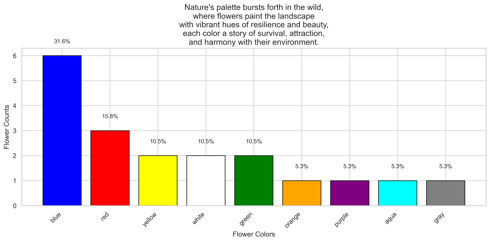

# Wikipedia Data Extraction: Scraping, OOP Modeling & Visualization

Python scraper that collects 1,000+ flower records from Wikipedia, models them with an object-oriented design, and visualizes color and habitat distributions.

## Features
- Scraper built with Beautiful Soup and Requests, with rate limiting and JSON export
- Data cleaning with Pandas and regex
- OOP model: `Flower` base class, `Wildflower` subclass, `Garden` class with search/filter methods
- Annotated bar and pie charts (Matplotlib, Seaborn)

## Tech
Python, BeautifulSoup, Requests, Pandas, Matplotlib, Seaborn
